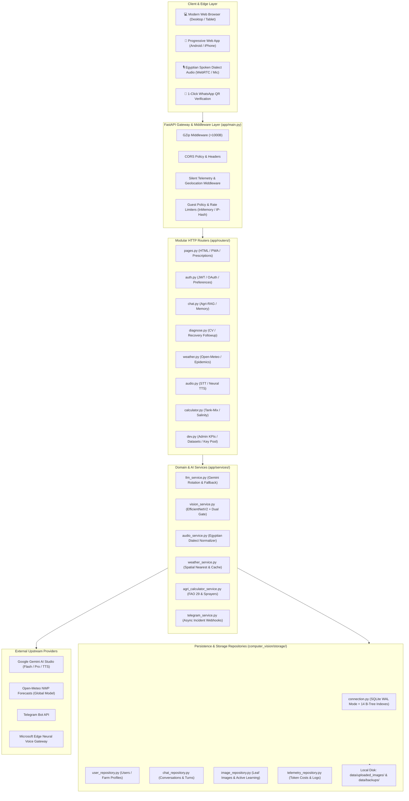
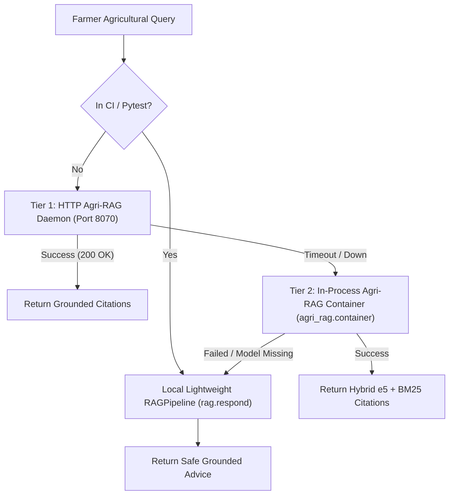

# PlantAPI — Architectural & Engineering Design Review
**Document Version:** 3.0.0  
**Status:** Approved Architectural Baseline  
**Target:** Unified FastAPI Gateway & Modular Agricultural Subsystems  

---

## 1. Architectural Overview & Design Philosophy

The PlantAPI platform follows a **Clean, Layered Architecture** with strict boundaries between transport protocols, domain logic, persistence, and external artificial intelligence providers. Rather than premature over-engineering with distributed microservices or heavyweight message queues, the platform adopts an efficient **modular monolith pattern** optimized for fast development, single-node low operational overhead, and deterministic execution on cost-effective cloud virtual machines.

### Architectural Diagram



---

## 2. Separation of Concerns & Coupling Evaluation

### 2.1 Core Module Boundaries
1. **Core (`app/core/`)**:
   - `config.py`: Single source of truth for runtime paths, environment variables, secret keys, and default agricultural crop registries.
   - `security.py`: Role-based authorization dependencies (`verify_dev_key`, `get_current_user_optional`, `get_current_user_required`).
   - `guest_policy.py`: Centralized policy for unauthenticated quota gating (`enforce_guest_gate_or_401`).
   - `rate_limiter.py`: Token bucket rate limiting protecting AI endpoints against abusive automated scrapers.
   - `telemetry.py`: Lightweight non-blocking ASGI middleware capturing latency and anonymized visitor telemetry.
2. **Schemas (`app/schemas/`)**:
   - Strictly typed Pydantic models with input sanitization, value boundaries (`ge=`, `le=`), and default values.
   - Eliminates direct dictionary indexing in business logic and guarantees clean OpenAPI documentation (`/docs`, `/redoc`).
3. **Routers (`app/routers/`)**:
   - Thin transport controllers responsible exclusively for parameter extraction, HTTP response status codes, and delegating computation to the Service Layer.
   - Routers contain no SQL queries or machine learning tensor manipulation.
4. **Services (`app/services/`)**:
   - Pure domain business logic and external integration clients.
   - Decoupled from HTTP specifics: services accept Python dataclasses, primitives, or byte streams, making them directly testable in unit tests without instantiating FastAPI requests.
5. **Storage Repositories (`computer_vision/storage/`)**:
   - Repository pattern encapsulating all SQLite SQL transactions.
   - Guarantees thread safety and connection release via context managers.

---

## 3. Synchronous vs. Asynchronous Execution Strategy

FastAPI executes all `async def` endpoints on the main asyncio event loop. If CPU-heavy tasks (such as TensorFlow image inference, image decoding with OpenCV/PIL, or SQLite synchronous disk I/O) run directly inside `async def` functions, they block the entire Python event loop, causing severe latency spikes for concurrent users.

### Architectural Solution
The PlantAPI gateway rigorously applies `asyncio.to_thread` for all blocking operations:

```python
# Asynchronous thread pool offloading for CPU and SQLite bound work
cv_task = asyncio.to_thread(cv.predict, image_stream, 3, model_choice)
gemini_gate_task = asyncio.to_thread(verify_plant_image_gemini_sync, image_bytes, content_type)
prediction, gemini_gate = await asyncio.gather(cv_task, gemini_gate_task)
```

**Benefits Verified in Audit:**
- **Zero Event Loop Starvation:** Heavy matrix multiplication and tensor convolutions in TensorFlow execute in worker threads, leaving the main event loop immediately responsive to health probes and concurrent requests.
- **Parallel I/O:** Parallel checks (such as OpenCV image quality analysis + Gemini Vision gatekeeper, or querying weather for multiple governorates) execute concurrently via `asyncio.gather`.
- **Background Fire-and-Forget:** Telemetry logging (`save_chat_log`, `save_token_usage_log`) is dispatched via `asyncio.create_task(asyncio.to_thread(...))` ensuring farmers receive immediate responses without waiting for database writes.

---

## 4. Fallback Chains & Resilience Boundaries

A hallmark of senior-grade production architecture is graceful degradation. The platform implements robust multi-tier fallback chains across its critical AI dependencies:

### 4.1 Agronomic RAG Fallback Chain


### 4.2 Speech Synthesis (TTS) Fallback Chain
1. **Tier 1 (Gemini 3.8 Neural Egyptian TTS)**: Generates high-fidelity authentic Egyptian colloquial speech.
2. **Tier 2 (Microsoft Edge Neural TTS — `ar-EG-ShakirNeural` / `ar-EG-SalmaNeural`)**: Triggers instantly if Gemini API is rate-limited (HTTP 429) or offline.
3. **Tier 3 (In-Memory Audio Cache)**: Identical recommendations are cached as MP3 bytes, resulting in 0ms synthesis time for repeated consultations.

### 4.3 Weather & Meteorological Data Fallback Chain
1. **Tier 1 (Open-Meteo Live API)**: Fetches real-time temperature, humidity, and wind speed.
2. **Tier 2 (15-Minute In-Memory Cache)**: Avoids redundant external HTTP calls for the same governorate.
3. **Tier 3 (Egyptian Historical Seasonal Baseline)**: If internet connectivity to Open-Meteo drops, the system defaults to statistically verified seasonal averages for the specific Egyptian governorate, ensuring the epidemic risk matrix never crashes.

---

## 5. Architectural Comparison: Current vs. Realistic Alternatives

To ensure sound engineering justifications, the current architecture was evaluated against alternative production designs:

| Dimension | Option A: Current Architecture (FastAPI + SQLite WAL + In-Process RAG) | Option B: Distributed Microservices (FastAPI Gateway + Celery/RabbitMQ + PostgreSQL) | Option C: Managed Cloud PaaS (Azure Functions + CosmosDB + Azure OpenAI) |
| :--- | :--- | :--- | :--- |
| **Operational Overhead** | **Very Low**: Single process/container, zero external brokers to maintain. | **High**: Requires maintaining RabbitMQ/Redis, worker nodes, and PostgreSQL clustering. | **Medium**: Vendor lock-in, proprietary APIs, complex local development. |
| **Hosting Cost** | **Very Low**: Runs comfortably on a standard Azure B2s VM (~$25/month). | **High**: Requires multiple VMs/services (minimum ~$150-$250/month). | **Variable/High**: Pay-per-execution and high egress costs for image payloads. |
| **Latency** | **Ultra-Low (<400ms)**: In-memory IPC, zero network hops between gateway and database. | **Medium (600-1200ms)**: Serialization and network hops across queues and microservices. | **Variable (800-2500ms)**: Cold starts and multi-region routing. |
| **Development & Debugging** | **Simple**: Reproducible locally on Windows/Linux with a single command. | **Complex**: Requires Docker Compose orchestration, distributed tracing, mock queues. | **Difficult**: Emulators are incomplete; debugging requires cloud connection. |
| **Target Workload Fit** | **Optimal**: Perfectly sized for 10,000 to 50,000 daily farmer consultations. | **Over-engineered**: Unjustified complexity for the current national deployment phase. | **Sub-optimal**: High cold start penalties for mobile farmers on 3G/4G in rural Egypt. |

### Architectural Conclusion
The current **modular monolith** with SQLite in WAL mode and layered asynchronous service boundaries is the **correct, justified engineering choice**. Introducing Kafka, RabbitMQ, or Kubernetes microservices at this stage would introduce substantial operational failure modes, network latency, and infrastructure cost without delivering any measurable benefit to Egyptian farmers.
