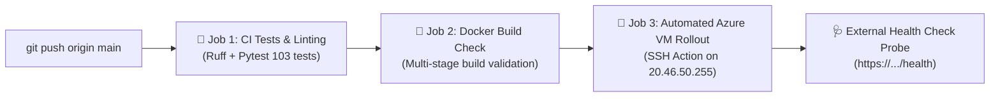

# PlantAPI — Production Deployment & Operational Readiness Guide
**Document Version:** 3.0.0  
**Environment:** Production Cloud Virtual Machine (`https://plantapi-abdo.uaenorth.cloudapp.azure.com`)  
**Host IP:** `20.46.50.255` (Azure UAE North Data Center)  
**Lead DevOps / SRE Engineer & Cloud Architect**  

---

## 1. Production Infrastructure Architecture

The PlantAPI platform runs on an **Azure Linux Virtual Machine** optimized for low-latency delivery across Egypt and the Middle East:

```
[Farmer Mobile / Web Browser]
            │ (HTTPS / Port 443)
            ▼
   [Cloudflare Edge CDN]
            │ (Reverse Proxy & SSL Termination)
            ▼
[Azure Linux VM: 20.46.50.255]
   ├── Nginx Web Server (Proxy pass to 127.0.0.1:8000)
   ├── Systemd Service: smart-agri.service (Uvicorn / FastAPI Gateway)
   ├── Python 3.12 Virtual Environment (/home/azureuser/smart-agriculture-ai/venv)
   ├── Local Persistent Storage:
   │     ├── data/predictions_history.db (SQLite with WAL Mode)
   │     ├── data/uploaded_images/ (Private 0700 leaf image store)
   │     └── data/backups/ (Automated database archives)
   └── External Egress:
         ├── Google Gemini Generative Language API
         ├── Open-Meteo Weather API
         └── Telegram Bot Webhook API
```

---

## 2. CI/CD Pipeline & Automated Rollout Workflow

The continuous deployment workflow is defined in `.github/workflows/ci_cd.yml` and triggers automatically on commits to the `main` branch:



### Rollout Script Executed on Azure VM
```bash
set -e
echo "📡 Connected to Azure VM: $(hostname)"
cd /home/azureuser/smart-agriculture-ai

# 1. Fetch and pull latest clean commits from main
git fetch origin main
git reset --hard origin/main

# 2. Check and install dependencies
./venv/bin/pip install -q --no-cache-dir -r requirements.txt

# 3. Restart systemd application service
sudo systemctl restart smart-agri

# 4. Proactive health probe retry loop (up to 30s warmup)
HEALTHY=false
for i in $(seq 1 15); do
  if curl -sf http://127.0.0.1:8000/health > /dev/null; then
    HEALTHY=true
    echo "✅ Service is online and healthy on attempt $i!"
    break
  fi
  sleep 2
done
```

---

## 3. Containerization (Docker & Compose)

The repository provides a production-grade multi-stage `Dockerfile`:
- **Stage 1 (Builder):** Uses `python:3.12-slim` to install dependencies into an isolated `/install` prefix using CPU-optimized PyTorch wheels.
- **Stage 2 (Runner):** Minimal runtime image running as a non-privileged system user (`appuser`, UID 1000).
- **Healthcheck:** Standard `curl -sf http://localhost:8000/health || exit 1`.
- **Entrypoint:** `uvicorn app.main:app --host 0.0.0.0 --port 8000`.

---

## 4. Operational Runbooks & Standard Operating Procedures

### 4.1 Service Management Commands
```bash
# Check real-time service status
sudo systemctl status smart-agri

# View live application logs
sudo journalctl -u smart-agri -f --no-tail

# Gracefully restart the gateway
sudo systemctl restart smart-agri

# Stop the gateway
sudo systemctl stop smart-agri
```

### 4.2 Database Backup & Recovery Runbook
- **Location of Database:** `data/predictions_history.db`
- **Location of Automated Backups:** `data/backups/`
- **Manual Hot Backup Creation (via API):**
  ```bash
  curl -X POST "https://plantapi-abdo.uaenorth.cloudapp.azure.com/api/dev/backups/create?key=DEV_SECRET_KEY"
  ```
- **Disaster Recovery Restore Procedure:**
  1. Stop the application service: `sudo systemctl stop smart-agri`.
  2. Locate the desired backup file in `data/backups/backup_YYYYMMDD_HHMMSS.db`.
  3. Replace the active database file:
     ```bash
     cp data/backups/backup_YYYYMMDD_HHMMSS.db data/predictions_history.db
     ```
  4. Ensure correct file permissions: `chmod 600 data/predictions_history.db`.
  5. Restart the service: `sudo systemctl start smart-agri`.
  6. Verify system health: `curl -sf http://127.0.0.1:8000/health`.

### 4.3 Emergency Rollback Procedure
If an unpredicted production defect occurs after a release:
```bash
# 1. SSH into the Azure production VM
ssh azureuser@20.46.50.255

# 2. Navigate to project root
cd /home/azureuser/smart-agriculture-ai

# 3. Rollback Git commit to known-good revision
git reset --hard 36c9860

# 4. Restart service
sudo systemctl restart smart-agri

# 5. Verify local health probe
curl -sf http://127.0.0.1:8000/health
```

### 4.4 Secret & Credential Rotation Procedure
1. **Gemini API Keys:** Add new keys or remove compromised keys live without restarting the server via the Developer Dashboard (`/dev-panel`) or POST `/api/dev/gemini-keys`.
2. **Telegram Alerts:** Update bot token and chat ID via POST `/api/dev/telegram-config?key=DEV_SECRET_KEY`.
3. **Developer Master Key:** Update `DEV_SECRET_KEY` in `/home/azureuser/smart-agriculture-ai/.env` and restart `sudo systemctl restart smart-agri`.
